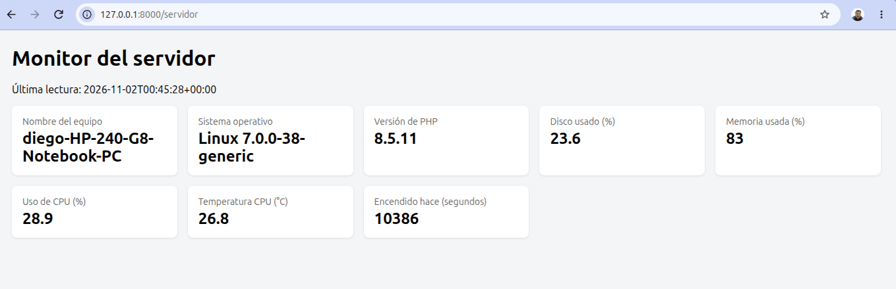
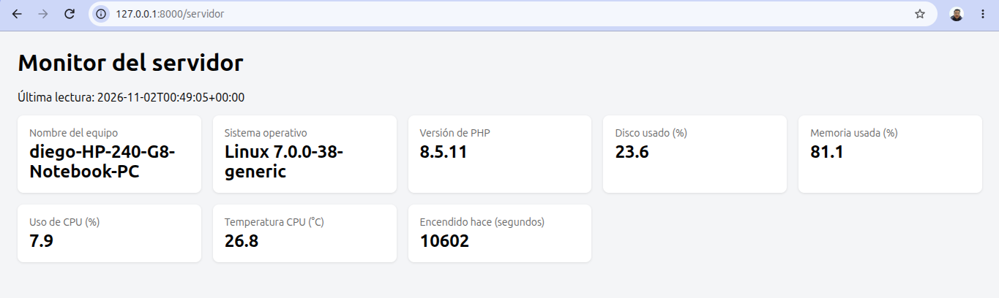
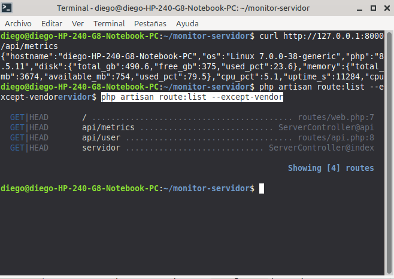
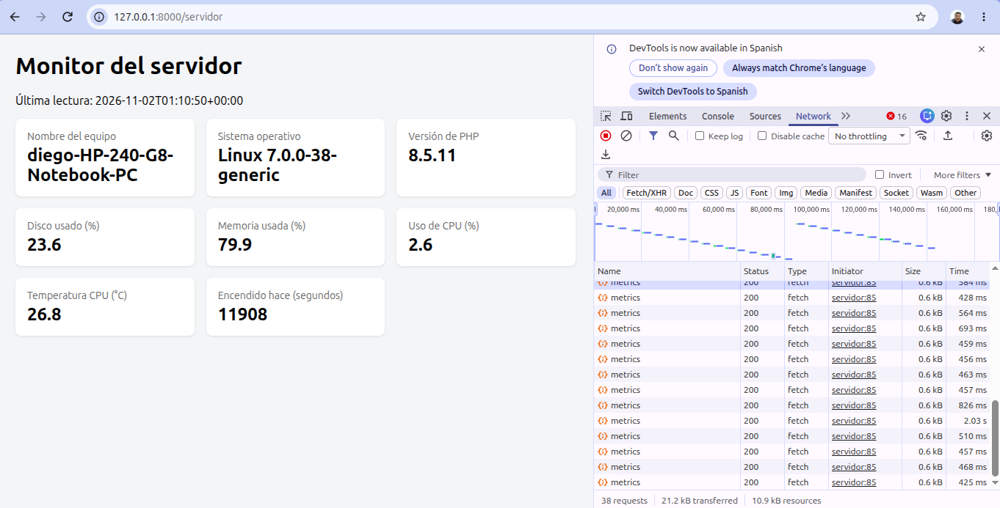
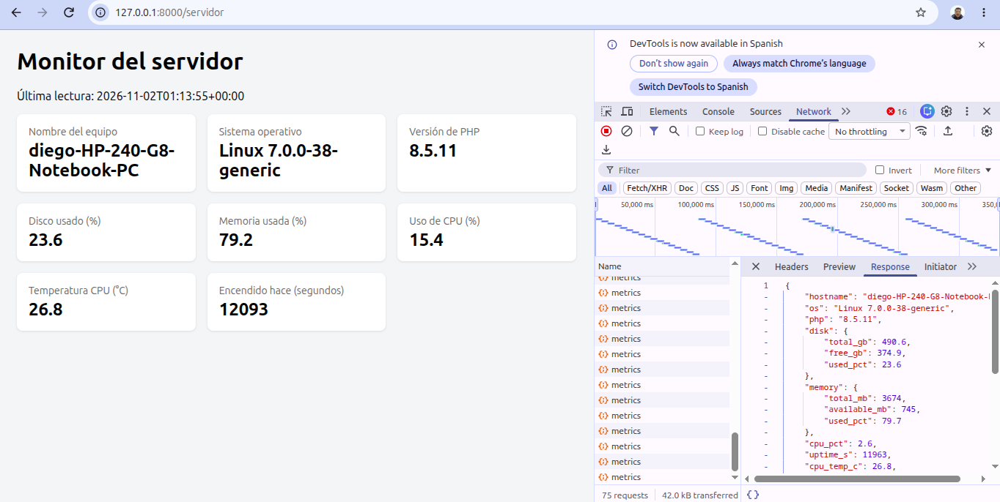

# Monitor de Servidor con Laravel

Trabajo práctico de **Programación IV** (UTN FRRe, cohorte 2026). Docentes: German Crozy y Fernando Aguirre.

Aplicación Laravel que lee datos del sistema operativo del servidor y los muestra de dos formas:

- una **vista web** en `/servidor`, que se actualiza sola cada 5 segundos (polling);
- una **API JSON** en `/api/metrics`.

Datos que muestra: nombre del equipo, sistema operativo, versión de PHP, uso de disco, uso de memoria, uso de CPU, tiempo encendido y temperatura de la CPU.

## Entorno usado

| | |
| --- | --- |
| Sistema operativo | Linux Mint 22.3 Zena (kernel 7.0.0-38-generic) |
| Equipo | HP 240 G8 Notebook PC |
| PHP | 8.5.11 |
| Laravel | Framework 13.39.0 |
| Editor | Visual Studio Code |

**Nota sobre el sistema operativo.** El enunciado está pensado para Windows, donde los datos se leen con PowerShell y WMI. Como trabajo en Linux Mint, agregué al service el método `readLinux()` (el desafío opcional del TP). Lee los mismos datos desde archivos del sistema:

| Dato | Windows (enunciado) | Linux (este proyecto) |
| --- | --- | --- |
| Memoria | `Win32_OperatingSystem` | `/proc/meminfo` |
| Uso de CPU | `Win32_Processor` | `/proc/stat` (dos lecturas con 0,2 s de diferencia) |
| Tiempo encendido | `LastBootUpTime` | `/proc/uptime` |
| Temperatura | `MSAcpi_ThermalZoneTemperature` | `/sys/class/thermal/thermal_zone0/temp` |

`snapshot()` elige el método según `PHP_OS_FAMILY`, y los dos devuelven las mismas claves. Por eso el controlador, la vista y la API funcionan igual en los dos sistemas. El código de Windows del enunciado se mantiene.

## Estructura

| Archivo | Qué hace |
| --- | --- |
| `app/Services/ServerMetrics.php` | Service: lee los datos del sistema (Windows o Linux) |
| `app/Http/Controllers/ServerController.php` | Controlador: `index` devuelve la vista, `api` devuelve JSON |
| `routes/web.php` | Ruta `GET /servidor` |
| `routes/api.php` | Ruta `GET /api/metrics`, limitada a 60 pedidos por minuto |
| `resources/views/servidor.blade.php` | Vista con las tarjetas y el script de polling |

## Cómo ejecutarlo

```bash
git clone <url-de-este-repositorio>
cd monitor-servidor
composer install
cp .env.example .env
php artisan key:generate
php artisan migrate
php artisan serve
```

Después abrir:

- http://127.0.0.1:8000/servidor
- http://127.0.0.1:8000/api/metrics

## Capturas

**Vista `/servidor` funcionando**



**La misma vista unos minutos después, con los valores actualizados**



**Respuesta de `/api/metrics` con curl y lista de rutas**



**Polling: un pedido a `metrics` cada 5 segundos (pestaña Network)**



**JSON que devuelve `/api/metrics` (pestaña Response)**



## Respuestas a las preguntas

### 1. ¿Por qué la temperatura suele aparecer como "No disponible" en Windows?

En Windows, la temperatura se lee de la clase WMI `MSAcpi_ThermalZoneTemperature`, que solo se puede consultar con permisos de administrador. Si la terminal no se abre como administrador, la consulta falla y el service deja el valor en `null`. Además, muchas placas madre no informan este dato a Windows, así que puede no aparecer ni siquiera como administrador.

En mi caso trabajé en Linux Mint, donde la temperatura se lee desde `/sys/class/thermal/thermal_zone0/temp` sin ser administrador. Por eso en mi equipo sí aparece (26,8 °C en las capturas). Ese archivo da el valor en milésimas de grado, por eso el código lo divide por 1000.

### 2. ¿Por qué el script de PowerShell nunca debe incluir datos que vengan del usuario?

Porque `shell_exec()` ejecuta un comando en el sistema operativo del servidor. Si una parte del comando viniera de un formulario, de la URL o de cualquier dato del usuario, alguien podría escribir otro comando en ese dato y el servidor lo ejecutaría. Esto se llama **inyección de comandos**, y permitiría leer archivos, borrar datos o tomar el control del servidor. Por eso el script es fijo y no recibe nada de afuera.

En la versión de Linux no uso `shell_exec()`: PHP lee los archivos directamente con `file_get_contents()`, sin ejecutar comandos.

### 3. ¿Qué riesgo tiene dejar `/api/metrics` sin autenticación en un servidor real?

- **Expone información de la infraestructura** a cualquiera: nombre del equipo, sistema operativo y versión, versión de PHP y uso de recursos. Un atacante puede usarla para buscar vulnerabilidades conocidas de esas versiones o para saber cuándo el servidor está sobrecargado.
- **Permite sobrecargar el servidor**: cada pedido ejecuta código que lee el sistema (en Windows, abre PowerShell). Muchos pedidos seguidos consumen CPU y memoria. El `throttle:60,1` limita los pedidos por dirección, pero no impide que cualquiera acceda.

En producción habría que protegerla con autenticación, por ejemplo con `->middleware('auth:sanctum')`, para que solo usuarios autorizados puedan consultarla.

### 4. Con polling cada 5 segundos, ¿cuántos pedidos por minuto recibe el servidor si hay 50 personas mirando?

Cada persona hace un pedido cada 5 segundos, es decir 60 / 5 = **12 pedidos por minuto**.

Con 50 personas: 50 × 12 = **600 pedidos por minuto** (10 por segundo), aunque los datos no hayan cambiado. Este es el problema que resuelven los WebSockets: el servidor envía los datos solo cuando hay una lectura nueva, sin que cada navegador tenga que preguntar.

### 5. Si una app solo necesita la temperatura, ¿qué datos recibe de más al llamar a `/api/metrics`?

Recibe todos los demás campos: `hostname`, `os`, `php`, `disk` (`total_gb`, `free_gb`, `used_pct`), `memory` (`total_mb`, `available_mb`, `used_pct`), `cpu_pct`, `uptime_s` y `at`. Solo usaría `cpu_temp_c`.

Esto se llama **over-fetching**: una API REST devuelve siempre la respuesta completa. Además, el servidor tiene que calcular todos esos datos aunque no se usen. GraphQL resuelve este problema, porque el cliente pide solo los campos que necesita.
