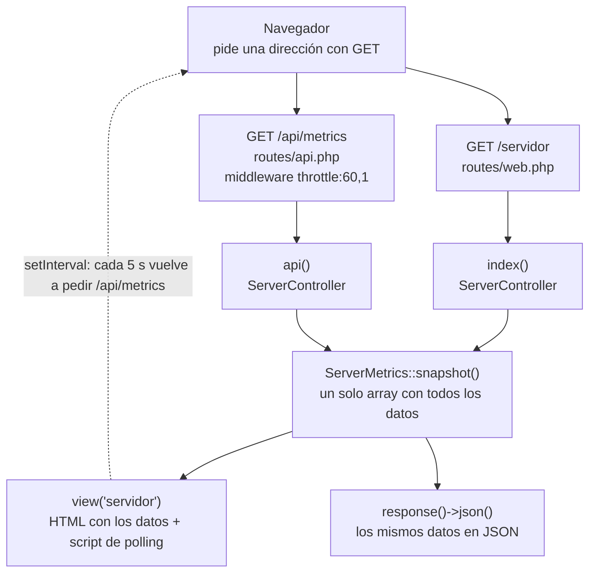
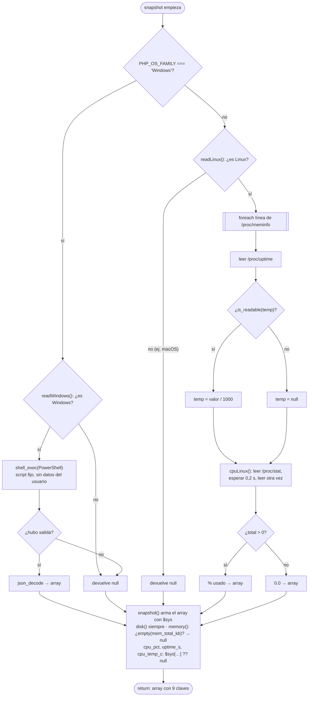
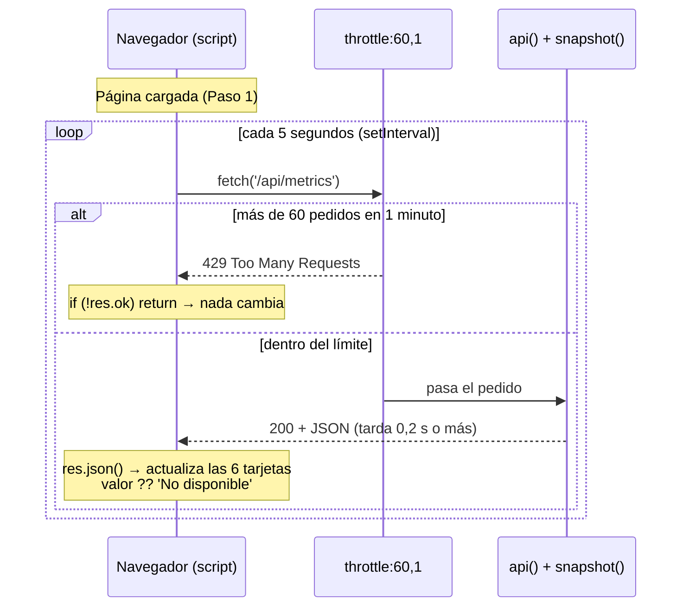

# Control de flujo del Monitor de Servidor

Cada pedido al monitor recorre siempre el mismo camino: navegador → ruta → controlador → service → respuesta. `/servidor` devuelve una página HTML y `/api/metrics` devuelve JSON. Después, la página vuelve a pedir `/api/metrics` cada 5 segundos para actualizarse sola.

> Los diagramas están en Mermaid: GitHub y VS Code (con la extensión "Markdown Preview Mermaid Support") los muestran dibujados.

## Conceptos antes de empezar

| Concepto | Qué es, en palabras simples | Dónde aparece en el TP |
| --- | --- | --- |
| Control de flujo | El orden en que se ejecuta el código, y las decisiones (`if`) y repeticiones (bucles) que cambian ese orden. | En todo el recorrido, sobre todo en `ServerMetrics.php` |
| Petición HTTP | El mensaje que manda el navegador al servidor. `GET` significa "quiero leer algo". | `GET /servidor`, `GET /api/metrics` |
| Ruta | La regla que dice qué código atiende cada dirección. | `routes/web.php`, `routes/api.php` |
| Middleware | Un control que se ejecuta antes del controlador, como un portero. | `throttle:60,1` |
| Controlador | La clase que recibe el pedido y decide qué responder. Delega el trabajo. | `ServerController.php` |
| Service | Una clase común de PHP donde vive la lógica. | `ServerMetrics.php` |
| Inyección de dependencias | Laravel crea el objeto `ServerMetrics` y se lo pasa al método, porque ve el tipo en los parámetros. | `index(ServerMetrics $metrics)` |
| Vista Blade | Plantilla HTML con huecos `{{ }}` que Laravel llena antes de enviarla. | `servidor.blade.php` |
| JSON | Formato de texto para enviar datos entre programas, con pares clave: valor. | Respuesta de `/api/metrics` |
| Polling | Preguntar al servidor cada cierto tiempo si hay datos nuevos. | `setInterval(actualizar, 5000)` |
| Condicional | Si se cumple algo, hace una cosa; si no, otra. Incluye `if`, `? :` y `??`. | `PHP_OS_FAMILY === 'Windows' ? … : …` |
| Bucle | Repetir un bloque de código varias veces. | `foreach` en `readLinux()`, `setInterval` |
| Operador `??` | "Si lo de la izquierda no existe o es null, usá lo de la derecha". | `$sys['cpu_pct'] ?? null` |

## Vista general

Los dos caminos se juntan en `snapshot()`, por eso muestran exactamente lo mismo. La línea punteada es el polling.

## Paso 1: la primera carga de /servidor

1. **El navegador pide `GET /servidor`.** Es un pedido normal, como abrir cualquier página.
2. **La ruta elige el controlador** (`routes/web.php`, línea 12). Laravel compara la dirección con la lista de rutas. Mostrar `03-terminal-api-rutas.png`.
3. **Laravel crea el service y llama a `index()`** (`ServerController.php`, línea 16). Nadie escribe `new ServerMetrics()`: es la inyección de dependencias.
4. **El controlador pide los datos**: `$metrics->snapshot()` (línea 20). El flujo entra al service (Paso 2).
5. **El controlador arma la vista**: `view('servidor', ['data' => …])`. Blade reemplaza cada `{{ }}` en el servidor; el navegador recibe HTML sin PHP.
6. **Blade decide qué mostrar si falta un dato**: `{{ $data['cpu_pct'] ?? 'No disponible' }}` (líneas 66 a 78). Mostrar `01-vista-servidor.png`.
7. **El navegador muestra la página y arranca** `setInterval(actualizar, 5000)` (línea 106). El servidor ya terminó con este pedido.

`/api/metrics` sigue el mismo camino, pero pasa antes por `throttle:60,1` y el controlador llama a `api()`, que devuelve `response()->json(…)`.

## Paso 2: adentro del service

| Estructura | Código (`ServerMetrics.php`) | Qué decide o repite | Cómo explicarlo |
| --- | --- | --- | --- |
| Ternario `? :` | Líneas 18-20 | Qué método lee el sistema | "Es un if/else en una línea". |
| `if` de guarda | Líneas 88 y 129 | Sale si no es el sistema esperado | "Un control en la puerta del método". |
| Ternario | Línea 123 | Si PowerShell devolvió algo | "Sin respuesta, no la convierto". |
| `foreach` | Líneas 136-141 | Cada línea de `/proc/meminfo` | "Pasa por cada renglón y guarda el número". |
| `if` | Línea 150 | Si existe el archivo de temperatura | "En una VM no hay sensor". |
| Ternario | Línea 185 | Evita dividir por cero | "Si no pasó tiempo, no divido". |
| `if` | Línea 70 | Si hay dato de memoria | "Sin total no hay porcentaje". |
| `??` | Líneas 40-42 | `null` si falta un dato | "El plan B". |

**CPU:** `/proc/stat` guarda tiempos acumulados desde que se prendió el equipo. Se lee dos veces con 0,2 s de diferencia y se compara cuánto creció el tiempo total y el ocioso. Analogía: mirar el cuentakilómetros dos veces para saber la velocidad.

## Paso 3: el polling cada 5 segundos

- **`async` / `await`:** `await` espera la respuesta sin congelar la página. Solo funciona dentro de una función `async`.
- **`res.ok`:** es `true` con códigos 200 a 299. Un `429` o un `500` lo ponen en `false`.
- **`?.` y `??` (línea 99):** `d.memory?.used_pct` no falla si `memory` es null, y `??` pone "No disponible".

Mostrar F12 → Network (`04-polling-network.png`) y la pestaña Response (`05-respuesta-json.png`). El primer `fetch` sale recién a los 5 s, porque los valores iniciales ya los escribió Blade.

## Observaciones para mencionar

| Punto | Qué pasa | Mejora posible |
| --- | --- | --- |
| Mismo `snapshot()` para vista y API | Los datos nunca se contradicen. | Es la idea central del diseño. |
| `readWindows()` y `readLinux()` devuelven las mismas claves | Controlador y vista no necesitan `if` por sistema. | Ejemplo de encapsular lo que cambia. |
| Guard al inicio de cada `read…()` | En macOS (`'Darwin'`) `readLinux()` devuelve null y la página muestra "No disponible". | Programación defensiva. |
| `disk()` divide por `$total` sin revisarlo | Si `disk_total_space()` diera `false`, la división por cero corta el pedido. | `if (!$total) return null;` |
| `memory()` solo revisa el total | No revisa `mem_free_kb`. | Revisar los dos. |
| Cada pedido tarda al menos 0,2 s | Por `usleep(200000)` en `cpuLinux()`. | Calcular en segundo plano y cachear. |
| `setInterval` no espera la respuesta | Si un pedido tarda más de 5 s, se superponen. | `setTimeout` al final de `actualizar()`. |
| `fetch` sin `try/catch` | Si el servidor se apaga, queda un error en consola. | `try/catch` y mostrar "Sin conexión". |
| `429` silencioso | 6 pestañas × 12 = 72 pedidos/min > 60. La pantalla queda quieta sin aviso. | Avisar si `res.status === 429`. |
| "No disponible" escrito dos veces | En Blade y en JavaScript. | Deuda técnica menor. |

## Guion de la exposición (unos 12 minutos)

1. **Qué hace la app (1 min).** Abrir `/servidor` o mostrar `01-vista-servidor.png`.
2. **Conceptos (2 min).** Ruta, controlador, service, JSON y polling.
3. **Vista general (2 min).** Recorrer el primer diagrama de arriba hacia abajo.
4. **Paso 1 en el código (2 min).** `web.php` y `ServerController.php` en VS Code.
5. **Paso 2, las decisiones (3 min).** Diagrama del service, después el `foreach`, el `is_readable` y la CPU.
6. **Paso 3, polling en vivo (2 min).** F12 → Network.
7. **Cierre (30 s).** Una o dos observaciones.

Antes de la clase: `php artisan serve` y las dos pestañas abiertas. Si algo falla, pasar a las capturas.

### Preguntas probables

- **¿Por qué un service?** Porque `index` y `api` necesitan los mismos datos: la lógica queda en un solo lugar.
- **¿Quién crea `ServerMetrics`?** Laravel, con la inyección de dependencias.
- **¿Por qué hay datos antes del primer polling?** Porque Blade los escribe en el servidor.
- **¿Qué pasa si un dato no se puede leer?** Queda en `null` por `??` y se muestra "No disponible".
- **¿Por qué se lee la CPU dos veces?** Porque `/proc/stat` acumula tiempos; solo la diferencia dice el uso actual.
- **¿Qué cambiarías para muchos usuarios?** WebSockets: el servidor envía datos solo cuando hay una lectura nueva.
