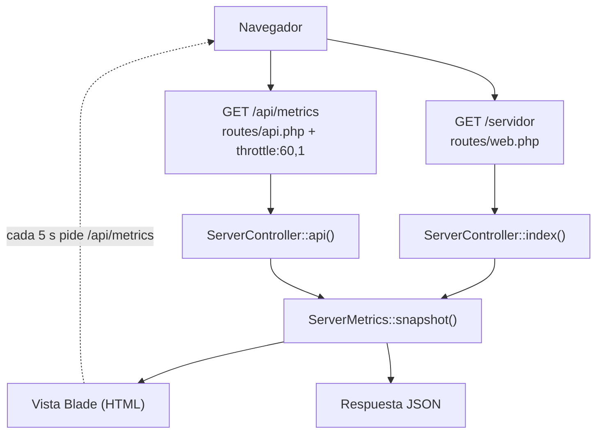
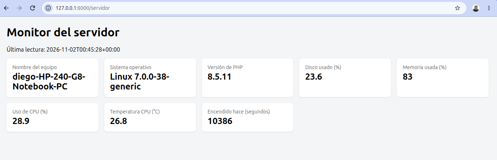
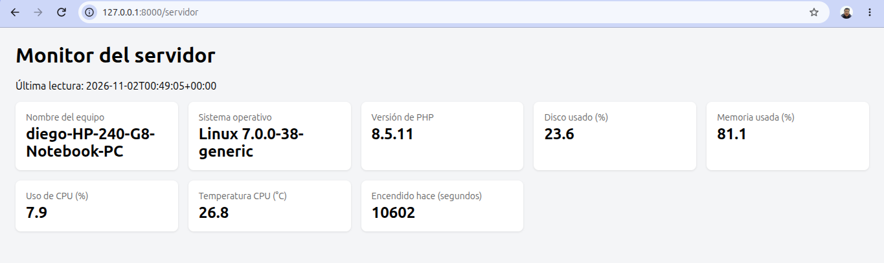
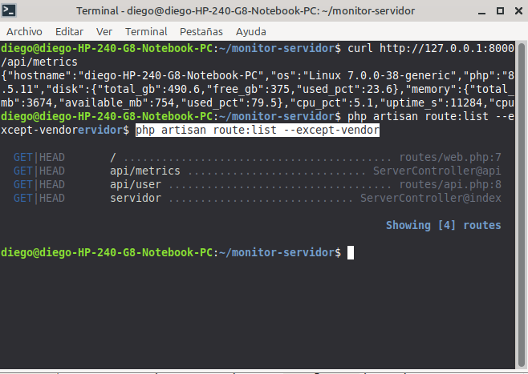
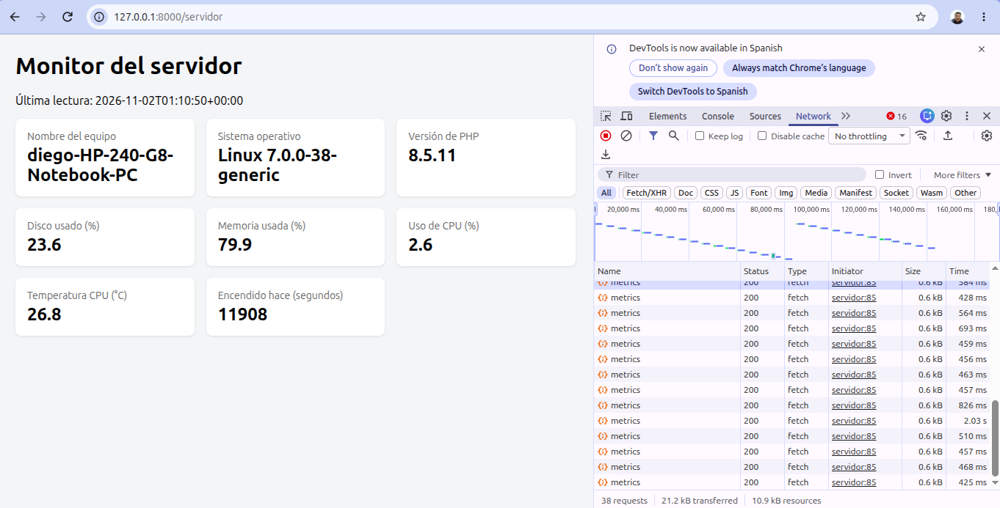
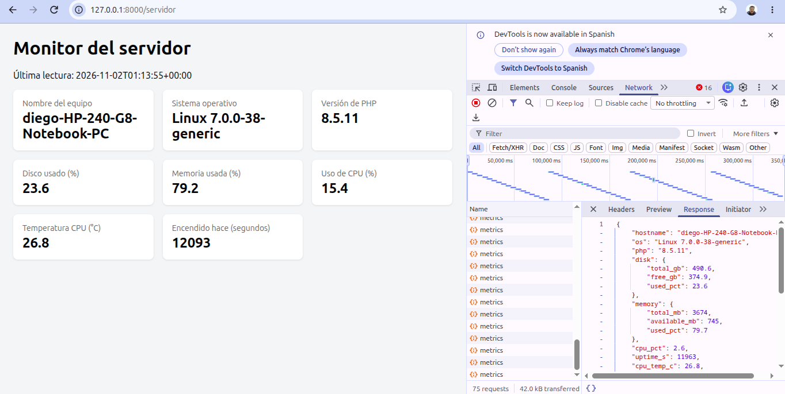

# Informe: Monitor de Servidor con Laravel

| | |
| --- | --- |
| Materia | Programación IV |
| Carrera | Técnico Universitario en Programación, UTN FRRe |
| Cohorte | 2026 |
| Docentes | Crozy, German · Aguirre, Fernando |
| Alumno | Cardozo, Diego F. |
| Fecha de entrega | <!-- completar --> |

## 1. Objetivo

El trabajo consiste en una aplicación Laravel que lee datos del sistema operativo del servidor donde corre y los muestra de dos maneras:

- una **página web** en `/servidor`, que se actualiza sola cada 5 segundos;
- una **API** en `/api/metrics`, que devuelve los mismos datos en formato JSON.

Los datos son: nombre del equipo, sistema operativo, versión de PHP, uso de disco, uso de memoria, uso de CPU, tiempo encendido y temperatura de la CPU.

La idea del TP es practicar el recorrido completo de un pedido en Laravel (ruta, controlador, service, vista y respuesta JSON) y ver cómo una página puede actualizarse sin recargarse.

## 2. Conceptos usados

Antes de describir el desarrollo, estos son los conceptos que aparecen en todo el informe.

| Concepto | Qué es | Dónde aparece |
| --- | --- | --- |
| Ruta | Regla que dice qué código atiende cada dirección (URL). | `routes/web.php`, `routes/api.php` |
| Controlador | Clase que recibe el pedido del navegador y decide qué responder. No hace el trabajo pesado, lo delega. | `ServerController.php` |
| Service | Clase común de PHP donde vive la lógica. En este caso, leer los datos del sistema. | `ServerMetrics.php` |
| Inyección de dependencias | Laravel ve que un método pide un objeto `ServerMetrics`, lo crea solo y se lo pasa. Nadie escribe `new ServerMetrics()`. | `index(ServerMetrics $metrics)` |
| Vista Blade | Plantilla HTML con huecos `{{ }}` que Laravel completa con datos antes de enviarla. | `servidor.blade.php` |
| JSON | Formato de texto para intercambiar datos entre programas, con pares `"clave": valor`. | Respuesta de `/api/metrics` |
| Middleware | Control que se ejecuta antes del controlador, como un portero. | `throttle:60,1` |
| Polling | El navegador le pregunta al servidor cada cierto tiempo si hay datos nuevos. | `setInterval(actualizar, 5000)` |

## 3. Entorno de trabajo

| | |
| --- | --- |
| Sistema operativo | Linux Mint 22.3 Zena (kernel 7.0.0-38-generic) |
| Equipo | HP 240 G8 Notebook PC |
| PHP | 8.5.11 |
| Laravel | Framework 13.39.0 |
| Editor | Visual Studio Code |
| Navegador | Google Chrome (herramientas de desarrollador, F12) |

El enunciado está pensado para Windows, donde los datos se obtienen con PowerShell. Como trabajo en Linux Mint, resolví el desafío opcional: agregué un método que lee los mismos datos desde archivos del sistema Linux. Esto se explica en la sección 5.2.

## 4. Arquitectura

### 4.1 Archivos del proyecto

| Archivo | Responsabilidad |
| --- | --- |
| `routes/web.php` | Define `GET /servidor` y lo conecta con `ServerController@index`. |
| `routes/api.php` | Define `GET /api/metrics`, lo conecta con `ServerController@api` y lo limita a 60 pedidos por minuto. |
| `app/Http/Controllers/ServerController.php` | `index()` devuelve la vista HTML; `api()` devuelve JSON. |
| `app/Services/ServerMetrics.php` | Lee los datos del sistema (Windows o Linux) y los devuelve en un array. |
| `resources/views/servidor.blade.php` | Muestra las tarjetas con los datos e incluye el script de polling. |

### 4.2 Recorrido de un pedido

Cada pedido sigue siempre el mismo camino:

```
Navegador → Ruta → (Middleware) → Controlador → Service → Respuesta (HTML o JSON)
```



La decisión de diseño más importante es que **la vista y la API usan el mismo método `snapshot()`**. Así la lógica está en un solo lugar y los dos caminos nunca muestran datos distintos. El controlador queda corto: solo pide los datos y elige el formato de la respuesta.

El recorrido completo, con cada decisión (`if`, `foreach`, ternarios) explicada paso a paso, está en [control-de-flujo.md](control-de-flujo.md).

## 5. Desarrollo

### 5.1 Rutas y controlador

En `routes/web.php` se agregó:

```php
Route::get('/servidor', [ServerController::class, 'index']);
```

En `routes/api.php` (que ya agrega el prefijo `/api`):

```php
Route::get('/metrics', [ServerController::class, 'api'])
    ->middleware('throttle:60,1');
```

`throttle:60,1` significa "como máximo 60 pedidos en 1 minuto desde la misma dirección". Si se pasa el límite, Laravel responde con el código `429 Too Many Requests`.

El controlador tiene dos métodos de una línea cada uno:

```php
public function index(ServerMetrics $metrics)
{
    return view('servidor', ['data' => $metrics->snapshot()]);
}

public function api(ServerMetrics $metrics)
{
    return response()->json($metrics->snapshot());
}
```

### 5.2 Service `ServerMetrics`

`snapshot()` es el único método público. Primero decide cómo leer el sistema según la constante `PHP_OS_FAMILY`:

```php
$sys = PHP_OS_FAMILY === 'Windows'
    ? $this->readWindows()
    : $this->readLinux();
```

Los dos métodos devuelven **las mismas claves** (`mem_total_kb`, `mem_free_kb`, `cpu_pct`, `uptime_s`, `temp_c`). Por eso el resto del programa no necesita saber en qué sistema está corriendo.

| Dato | Windows (código del enunciado) | Linux (agregado por mí) |
| --- | --- | --- |
| Memoria | `Win32_OperatingSystem` | `/proc/meminfo` |
| Uso de CPU | `Win32_Processor` | `/proc/stat`, leído dos veces con 0,2 s de diferencia |
| Tiempo encendido | `LastBootUpTime` | `/proc/uptime` |
| Temperatura | `MSAcpi_ThermalZoneTemperature` | `/sys/class/thermal/thermal_zone0/temp` |

Los datos que no dependen del sistema operativo se obtienen con funciones propias de PHP: `gethostname()`, `php_uname()`, `PHP_VERSION`, `disk_total_space()` y `disk_free_space()`.

Detalles de la versión Linux:

- **Memoria.** Se recorre `/proc/meminfo` con un `foreach`, línea por línea, y se guarda cada valor. Para la memoria libre uso `MemAvailable` y no `MemFree`, porque `MemAvailable` es la memoria que realmente puede usar un programa nuevo.
- **CPU.** `/proc/stat` no guarda el uso actual, sino tiempos acumulados desde que se prendió el equipo. Por eso se lee dos veces, con 0,2 segundos de diferencia, y se calcula cuánto de ese tiempo estuvo la CPU ociosa. Es como mirar el cuentakilómetros dos veces para saber la velocidad.
- **Temperatura.** El archivo da el valor en milésimas de grado (26800 = 26,8 °C), por eso se divide por 1000. Antes se revisa con `is_readable()` que el archivo exista, porque en una máquina virtual puede no haber sensor.
- **Sin comandos.** En Linux no se usa `shell_exec()`: PHP lee los archivos directamente con `file()` y `file_get_contents()`.

Si algún dato no se puede leer, el operador `??` lo deja en `null` y la aplicación no se rompe. La vista muestra "No disponible" en ese caso.

### 5.3 Vista y polling

La vista `servidor.blade.php` muestra una tarjeta por dato, en una grilla CSS que se adapta al ancho de la pantalla. La primera vez, Blade escribe los valores en el servidor, así la página ya llega con datos.

Después, un script de JavaScript actualiza las tarjetas cada 5 segundos:

```js
async function actualizar() {
    const res = await fetch('/api/metrics');
    if (!res.ok) return;
    const d = await res.json();
    document.getElementById('cpu').textContent = d.cpu_pct ?? 'No disponible';
    // ... lo mismo con las demás tarjetas
}
setInterval(actualizar, 5000);
```

- `fetch` hace el pedido a la API sin recargar la página.
- `await` espera la respuesta sin congelar la página (solo funciona dentro de una función `async`).
- `if (!res.ok) return;` evita romper la pantalla si la API responde con un error, por ejemplo un `429`.
- Solo se actualizan los datos que cambian (disco, memoria, CPU, temperatura y tiempo encendido). Nombre del equipo, sistema operativo y versión de PHP quedan fijos.

## 6. Endpoints

| Método | URL | Respuesta | Protección |
| --- | --- | --- | --- |
| GET | `/servidor` | Página HTML | Ninguna |
| GET | `/api/metrics` | JSON | `throttle:60,1` |

Ejemplo de respuesta de `/api/metrics`, tomado de la captura 05:

```json
{
  "hostname": "diego-HP-240-G8-Notebook-PC",
  "os": "Linux 7.0.0-38-generic",
  "php": "8.5.11",
  "disk": { "total_gb": 490.6, "free_gb": 374.9, "used_pct": 23.6 },
  "memory": { "total_mb": 3674, "available_mb": 745, "used_pct": 79.7 },
  "cpu_pct": 2.6,
  "uptime_s": 11963,
  "cpu_temp_c": 26.8,
  "at": "2026-11-02T01:13:55+00:00"
}
```

## 7. Resultados

**Vista `/servidor` funcionando.** Se ven las ocho tarjetas con datos reales, incluida la temperatura (26,8 °C).



**La misma vista unos minutos después.** Los valores cambiaron solos, sin recargar la página: la memoria pasó de 83 % a 81,1 %, la CPU de 28,9 % a 7,9 % y el tiempo encendido de 10386 a 10602 segundos.



**Prueba de la API con `curl` y lista de rutas** (`php artisan route:list`).



**Polling en la pestaña Network.** Aparece un pedido `metrics` cada 5 segundos.



**JSON devuelto por `/api/metrics`** en la pestaña Response.



## 8. Respuestas a las preguntas del enunciado

**1. ¿Por qué la temperatura suele aparecer como "No disponible" en Windows?**
Porque la clase WMI `MSAcpi_ThermalZoneTemperature` solo se puede consultar con permisos de administrador, y además muchas placas madre no informan ese dato. En Linux se lee desde `/sys/class/thermal/thermal_zone0/temp` sin ser administrador, por eso en mi equipo sí aparece.

**2. ¿Por qué el script de PowerShell nunca debe incluir datos del usuario?**
Porque `shell_exec()` ejecuta un comando en el servidor. Si parte del comando viniera del usuario, alguien podría agregar otro comando y el servidor lo ejecutaría. Esto se llama **inyección de comandos**. Por eso el script es fijo.

**3. ¿Qué riesgo tiene dejar `/api/metrics` sin autenticación?**
Cualquiera puede ver el nombre del equipo, el sistema, las versiones y el uso de recursos, y usar esa información para buscar vulnerabilidades. También puede hacer muchos pedidos y sobrecargar el servidor. El `throttle` limita los pedidos, pero no impide el acceso. En producción habría que agregar autenticación, por ejemplo `auth:sanctum`.

**4. Con polling cada 5 segundos y 50 personas mirando, ¿cuántos pedidos por minuto recibe el servidor?**
Cada persona hace 60 / 5 = 12 pedidos por minuto. Con 50 personas: 50 × 12 = **600 pedidos por minuto**, aunque los datos no cambien. Los WebSockets resuelven esto, porque el servidor envía datos solo cuando hay una lectura nueva.

**5. Si una app solo necesita la temperatura, ¿qué recibe de más?**
Recibe todos los demás campos (`hostname`, `os`, `php`, `disk`, `memory`, `cpu_pct`, `uptime_s`, `at`). Esto se llama **over-fetching**. GraphQL lo resuelve porque el cliente pide solo los campos que necesita.

## 9. Mejoras posibles

Revisando el código encontré puntos que se podrían mejorar en una versión siguiente:

| Situación actual | Mejora |
| --- | --- |
| `disk()` divide por el total sin revisar que exista. Si `disk_total_space()` falla, hay división por cero. | Devolver `null` si no hay total. |
| Cada pedido tarda al menos 0,2 s por la doble lectura de la CPU. | Calcular los datos en segundo plano y guardarlos en caché. |
| `setInterval` no espera la respuesta anterior. Si un pedido tarda más de 5 s, se superponen. | Usar `setTimeout` al final de `actualizar()`. |
| Si el servidor se apaga, `fetch` deja un error en la consola. | Envolver en `try/catch` y mostrar "Sin conexión". |
| Si se supera el límite (`429`), la pantalla deja de actualizarse sin avisar. Con 6 pestañas abiertas ya se llega a 72 pedidos por minuto. | Mostrar un aviso cuando `res.status === 429`. |
| La API no tiene autenticación. | Protegerla con `auth:sanctum`. |

## 10. Conclusiones

- Separar la lógica en un **service** permitió que la vista y la API usen el mismo código, sin repetir nada. El controlador solo coordina.
- Hacer que `readWindows()` y `readLinux()` devuelvan las mismas claves permitió agregar soporte para Linux sin tocar el controlador ni la vista. Lo que cambia según el sistema queda encerrado en un solo lugar.
- Usar `??` y devolver `null` cuando falta un dato hace que la aplicación siga funcionando aunque una lectura falle.
- El **polling** es simple de implementar, pero genera muchos pedidos cuando hay muchos usuarios. Para un monitor real convendría usar WebSockets.
- Una API que expone datos del servidor necesita, además del límite de pedidos, autenticación.

## Cómo ejecutar el proyecto

```bash
composer install
cp .env.example .env
php artisan key:generate
php artisan migrate
php artisan serve
```

Después abrir `http://127.0.0.1:8000/servidor` y `http://127.0.0.1:8000/api/metrics`.
